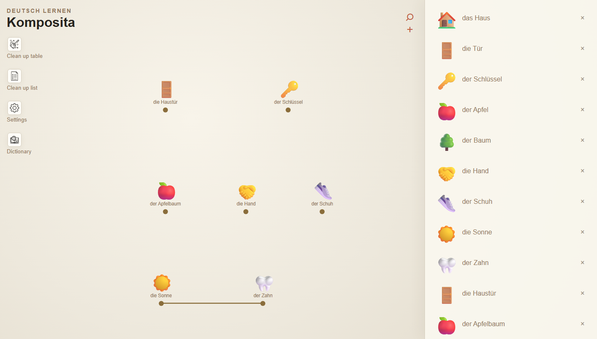

# Komposita

A small game for playing with German compound nouns. You link *Haus* and *Tür* and get *die Haustür*. Add *Schlüssel* and you get *der Haustürschlüssel*.

**Play it here: https://gabrielcbomfim.github.io/Komposita/** (use a computer, dragging doesn't work on touch screens yet).



I made this for the Linguistics seminar at École Polytechnique.

## Why

German builds new words by gluing existing ones together, and there's no real limit to how far it goes. *Hand* + *Schuh* is a glove. *Quarzstaublungenerkrankung* is a lung disease caused by quartz dust. I wanted something like Little Alchemy where the recipes aren't invented by me but come from the language itself.

So there's no hand-written recipe list. I extracted about 83,000 German entries from Wiktionary, and the game knows around 38,500 compounds from that data.

## The linguistics part

These are the things the game is built around:

- **The head is on the right.** A *Haustür* is a kind of door, not a kind of house. So order matters in the game: *Haus + Tür* works, *Tür + Haus* doesn't. Words are read left to right on the table.
- **The head gives the gender.** *das Haus + die Tür = die Haustür*, then *+ der Schlüssel = der Haustürschlüssel*. Nouns always show their article, so you can see the gender follow the last word.
- **It's recursive.** A compound can contain another compound: *[[Haus·tür]·schlüssel]*. The game reduces everything to its roots, so *Haus + Tür + Schlüssel* and *Haustür + Schlüssel* both work.
- **Linking elements (Fugenelemente).** Things like *-s-*, *-n-*, *-er-*: *Sonne**n**blume*, *Wört**er**buch*, *Weihnacht**s**baum*. The data keeps them (`Wort + -er- + Buch`), but you don't need to know them to play. *Wort + Buch* gives *Wörterbuch*.

Failing is part of it too. *Sonne + Zahn* just stays two words, because that compound doesn't exist.

## How to play

- You start with *Haus*, *Tür*, *Schlüssel* and *Schuh*. There are five compounds hidden in those four.
- Drag words from the list on the right onto the table.
- Drag from one word's dot (●) to another's to link them. If the group makes a real compound (read left to right), it turns into the new word.
- Double-click a line to unlink. Move words around to change the order.
- **+** adds any German word to your list. Case matters: `Orange` is the fruit, `orange` is the color.
- **Dictionary** shows what you've found. **Settings** has sound and a short tutorial.

## Running it locally

It's plain HTML/CSS/JS, nothing to build. It just needs to be served over HTTP because it loads the dictionary with `fetch`:

```bash
git clone https://github.com/gabrielcbomfim/Komposita.git
cd Komposita
npx http-server -c-1 -o
# or: python -m http.server 8000
```

The online version is GitHub Pages on `main`.

## How it works

There are two halves: a Node pipeline that builds the dictionary once, and the game in the browser that uses it.

**Building the dictionary** ([`scripts/build-dictionary.js`](scripts/build-dictionary.js)). It reads the Wiktionary dump from [kaikki.org](https://kaikki.org/dictionary/German/) and keeps one line per German word:

```json
{"word":"Haustürschlüssel","partOfSpeech":"noun","article":"der","isCompound":true,"components":["Haustür","Schlüssel"],"emoji":"🔑"}
```

To find out whether a noun is a compound, it tries, in order:

1. Wiktionary's etymology templates (`compound`, `affix`, `surface analysis`...).
2. An `X + Y` pattern in the etymology text.
3. A second pass of my own for nouns Wiktionary doesn't analyse. It tries to cut the word into `modifier + (linking element) + head`, where every piece has to exist in the dictionary and the head has to be a noun. It prefers balanced cuts and noun modifiers (*Bahnhof + Straße*, not *Bahn + Hofstraße*). This found 4,335 more compounds.

Emojis are picked offline: first an exact match in the Unicode emoji names, then the small [Emo](https://www.npmjs.com/package/@desert-ant-labs/emo) model, and for compounds the emoji of the head (*Handschuh* gets the shoe). There's also [`generate-emojis-ai.js`](scripts/generate-emojis-ai.js) to redo them with an LLM.

**Crafting** ([`js/crafting.js`](js/crafting.js)). Every compound gets broken down recursively into its roots, linking elements are dropped, and the ordered roots become the recipe key:

```
Haustürschlüssel -> [Haustür, Schlüssel] -> [[Haus, Tür], Schlüssel] -> haus|tür|schlüssel
```

When you link words on the table, the same thing happens to them, and if the key matches, you get the word. You can try it in the terminal:

```bash
node scripts/crafting-demo.js Haus Tür Schlüssel
# ✅ Haus + Tür + Schlüssel  =>  Haustürschlüssel
```

Some numbers from the data:

| | |
|---|---:|
| Entries | 83,147 |
| Nouns | 55,574 |
| Compound nouns | 38,585 |
| ...found by my decomposition pass | 4,335 |
| Recipes you can actually craft | 28,560 |

## Rebuilding the data

Only needed if you want to regenerate `data/german-words.jsonl` (Node 18+):

```bash
npm install
npm run build:dictionary -- path/to/kaikki-german.jsonl data/german-words.jsonl
# LIMIT=300 for a quick test

# optional, emojis with an LLM:
export OPENROUTER_API_KEY=...
npm run generate:emojis
```

## What's in the repo

```
index.html, css/, js/     the game
data/german-words.jsonl   the generated dictionary
assets/                   icons and music
scripts/                  the data pipeline
```

## What doesn't work (yet)

- Only nouns can be crafted. Verb and adjective compounds (*kennenlernen*, *hellblau*) are in the data but not used.
- The data is heuristic. Some splits are wrong and some emojis are just bad guesses (*Hand* is 🤝).
- If two compounds have the same roots, only one survives as a recipe.
- Progress isn't saved when you reload.
- Ideas: show the bracket tree of a word you found, highlight the Fugenelement, a mode where you guess the gender from the head, and using AI to generate new compounds and emojis.

## Who did what

The idea, the architecture and the scripts (the dictionary pipeline, the compound detection, the crafting logic) are mine. I used Claude (Anthropic) for the frontend.

## Credits

- Code: [MIT](LICENSE), Gabriel ([@gabrielcbomfim](https://github.com/gabrielcbomfim)).
- Word data from [Wiktionary](https://www.wiktionary.org/), via [kaikki.org / wiktextract](https://kaikki.org/) (Tatu Ylonen, LREC 2022). It's CC BY-SA 4.0, so `data/german-words.jsonl` is too.
- Emoji data: [Emojibase](https://emojibase.dev/) and Unicode CLDR. Emoji model: [Emo](https://www.npmjs.com/package/@desert-ant-labs/emo) by Desert Ant Labs.
- Music: Johann Sebastian Bach.
