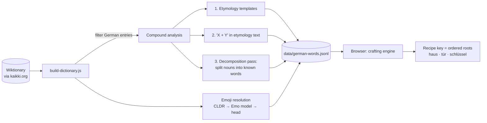

<div align="center">

# 🧩 Komposita

**A word-crafting game for learning German compound nouns.**

Link *Haus* 🏠 and *Tür* 🚪 and get ***die Haustür***. Add *Schlüssel* 🔑 and you've built ***der Haustürschlüssel***.

[](LICENSE)
[](#credits--licenses)


</div>

---

## About

German forms new words by stacking existing ones (*Hand* + *Schuh* → *Handschuh*, "hand shoe" = glove), and it can keep stacking them with no fixed limit. **Komposita** turns that into a game in the spirit of *Little Alchemy*: you put words on a table, link them, and if together they make a real German compound, a new word appears.

You don't play against a hand-written recipe list. Every recipe comes from **~83,000 German entries extracted from Wiktionary**, so the game knows about **38,585 compounds**, everyday ones like *Kühlschrank* and less common ones like *Quarzstaublungenerkrankung*.

> Built as a project for the **Linguistics seminar at École Polytechnique**.

## The linguistics behind the game

The game's rules are based on how German compounds (*Determinativkomposita*) actually work:

| Property | In German | In the game |
|---|---|---|
| **Right-headed** | The last element is the head and sets the meaning: a *Haustür* is a kind of *Tür* (door), not a kind of house. | **Order matters.** Words are read left to right on the table. *Haus + Tür* works, *Tür + Haus* does not. |
| **The head sets the gender** | *das Haus + die Tür → **die** Haustür*; *+ der Schlüssel → **der** Haustürschlüssel*. | Every noun is shown with its article, so you can watch the gender follow the head. |
| **Recursive** | Compounds can contain compounds: *[[Haus·tür]·schlüssel]*. | Each compound is reduced to its **roots**, so *Haus + Tür + Schlüssel* and *Haustür + Schlüssel* both work. |
| **Linking elements** (*Fugenelemente*) | Elements like *-s-*, *-n-*, *-er-*, *-en-* often appear at the boundary: *Sonne**n**blume*, *Wört**er**buch*, *Weihnacht**s**baum*. | The data records them (`Wort + -er- + Buch`), but the player doesn't have to type them: *Wort + Buch* gives *Wörterbuch*. |

Players get these patterns by using them, not by memorising rules. A failed combination is useful too: *Sonne + Zahn* stays two separate words, because no such compound exists.

## How to play

1. You start with four words: *Haus*, *Tür*, *Schlüssel* and *Schuh*. Between them they hide five compounds. To add more, click **+** and type any German word (e.g. `Hand`), then press <kbd>Enter</kbd>. Typing `die orange` or `Orange` picks the noun; `orange` picks the adjective.
2. **Drag** words from the list on the right onto the table.
3. **Link** two words by dragging from one word's dot (●) to another's. If the linked group, read left to right, forms a compound, it merges into the new word.
4. **Double-click** a line to unlink. Move words around to change the reading order.
5. Open **Dictionary** to see every compound you've discovered.

Use **⌕** to filter your word list by name or part of speech. **Settings** controls music and sound effects and has a short **How to play** tutorial.

## Getting started

The game is a **static site** with no build step and no dependencies. Because it loads the dictionary with `fetch`, it has to be served over HTTP (opening `index.html` directly from disk won't work):

```bash
git clone https://github.com/gabrielcbomfim/Komposita.git
cd Komposita

npx http-server -c-1 -o     # or: npm start
# or
python -m http.server 8000  # then open http://localhost:8000
```

To publish it, enable **GitHub Pages** on the `main` branch: the repository is already a deployable site.

## How it works



### 1. Building the dictionary (offline)

[`scripts/build-dictionary.js`](scripts/build-dictionary.js) streams the Wiktionary dump and keeps one clean entry per German word:

```json
{"word":"Haustürschlüssel","partOfSpeech":"noun","article":"der","isCompound":true,"components":["Haustür","Schlüssel"],"emoji":"🔑","emojiSource":"component"}
```

**Compound detection** uses three sources, in order of reliability:

1. Wiktionary's etymology templates (`compound`, `affix`, `surface analysis`…).
2. An `X + Y` pattern in the free-text etymology.
3. A **decomposition pass** for nouns Wiktionary doesn't analyse. It tries to split a noun into `modifier + [linking element] + head`, where every part must itself be a dictionary word and the head must be a noun. Balanced splits and noun modifiers are preferred (*Bahnhof + Straße*, not *Bahn + Hofstraße*). This pass finds **4,335** extra compounds.

**Emojis** are chosen fully offline, from the most to the least reliable source: an exact match in the Unicode CLDR emoji names (in German, then the English glosses), then the [Emo](https://www.npmjs.com/package/@desert-ant-labs/emo) on-device model, then, for compounds, **the emoji of the head** (*Handschuh* → *Schuh*), which is the same right-headedness the game teaches. An optional script, [`generate-emojis-ai.js`](scripts/generate-emojis-ai.js), can improve them with an LLM.

### 2. Crafting (in the browser)

[`js/crafting.js`](js/crafting.js) reduces every compound **recursively** to its primitive roots, drops linking elements, and indexes it by the *ordered* list of roots:

```
Haustürschlüssel → [Haustür, Schlüssel] → [[Haus, Tür], Schlüssel] → haus|tür|schlüssel
```

When you link words, the same reduction runs on them, so any bracketing of the same roots in the same order gives the same word. You can try the engine from the command line:

```bash
node scripts/crafting-demo.js Haus Tür Schlüssel
# ✅ Haus + Tür + Schlüssel  =>  Haustürschlüssel
```

### The dataset at a glance

| | |
|---|---:|
| Entries | 83,147 |
| Nouns · adjectives · verbs · adverbs · pronouns · prepositions | 55,574 · 15,766 · 9,624 · 1,881 · 155 · 147 |
| Compound nouns | 38,585 |
| … of which found by the decomposition pass | 4,335 |
| Craftable recipes (≥ 2 roots in the dictionary) | 28,560 |

## Project structure

```
Komposita/
├── index.html               # the game (single page)
├── css/style.css
├── js/
│   ├── main.js              # app wiring
│   ├── dictionary.js        # loads and searches the word list
│   ├── crafting.js          # recipe engine (roots → compound)
│   ├── workspace.js         # the table: tokens, links, combining
│   ├── word-list.js         # right-hand word list
│   ├── search-panel.js      # filter the word list
│   ├── add-word-panel.js    # add words from the dictionary
│   ├── action-button.js     # base class for the left-rail dialogs
│   ├── clean-up-*.js, settings-button.js, dictionary-button.js
│   ├── emoji-service.js     # drag image, optional emoji server
│   └── audio.js             # synthesized effects + music
├── data/german-words.jsonl  # generated dictionary (one JSON entry per line)
├── assets/                  # icons and music
└── scripts/                 # offline data pipeline (Node.js)
    ├── build-dictionary.js
    ├── generate-emojis-ai.js
    └── crafting-demo.js
```

## Rebuilding the data

You only need this to regenerate `data/german-words.jsonl`. Requires Node.js ≥ 18.

```bash
npm install

# 1. Download the German Wiktionary extract (JSONL) from https://kaikki.org/dictionary/German/
# 2. Build the dictionary (LIMIT=300 for a quick test run)
npm run build:dictionary -- path/to/kaikki-german.jsonl data/german-words.jsonl

# 3. (Optional) Improve emojis with an LLM via OpenRouter
export OPENROUTER_API_KEY=sk-or-...    # keep keys in env vars, never in the repo
npm run generate:emojis
```

The game picks up `data/german-words-with-emojis-ai.jsonl` automatically if it exists.

## Limitations & future work

- **Only nouns are crafted.** Verb and adjective compounds (*kennenlernen*, *hellblau*) are in the data but aren't recipes yet.
- **Heuristic data.** Etymology parsing and the decomposition pass can produce false splits, and some emojis are rough guesses (*Hand* → 🤝).
- **No ambiguity handling.** If two compounds reduce to the same roots, only one of them is kept as a recipe.
- **Progress isn't saved** between sessions yet.
- Possible next steps: show the bracketing tree of a discovered compound, mark the *Fugenelement* explicitly, and add a game mode where the player has to guess the gender from the head.

## Credits & licenses

- **Code:** [MIT](LICENSE) © 2026 Gabriel ([@gabrielcbomfim](https://github.com/gabrielcbomfim)).
- **Lexical data:** derived from [Wiktionary](https://www.wiktionary.org/) via [kaikki.org / wiktextract](https://kaikki.org/) (Tatu Ylonen, *Wiktextract: Wiktionary as Machine-Readable Structured Data*, LREC 2022). Wiktionary content is licensed under [CC BY-SA 4.0](https://creativecommons.org/licenses/by-sa/4.0/), so `data/german-words.jsonl` is distributed under the same license.
- **Emoji metadata:** [Emojibase](https://emojibase.dev/) (MIT) and Unicode CLDR.
- **Emoji model:** [Emo](https://www.npmjs.com/package/@desert-ant-labs/emo) by Desert Ant Labs.
- **Icons and music:** _add source and license here._

<div align="center">
<sub>Viel Spaß beim Zusammensetzen! 🧩</sub>
</div>
